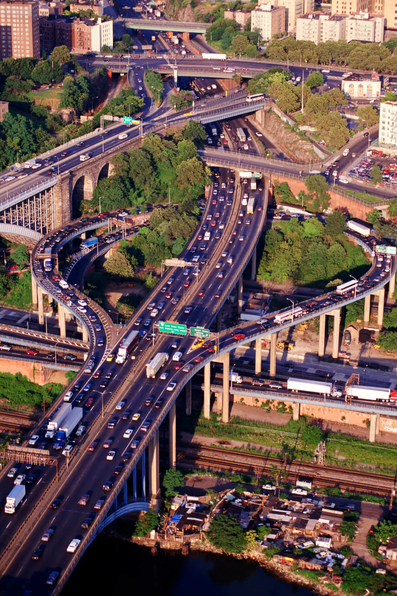
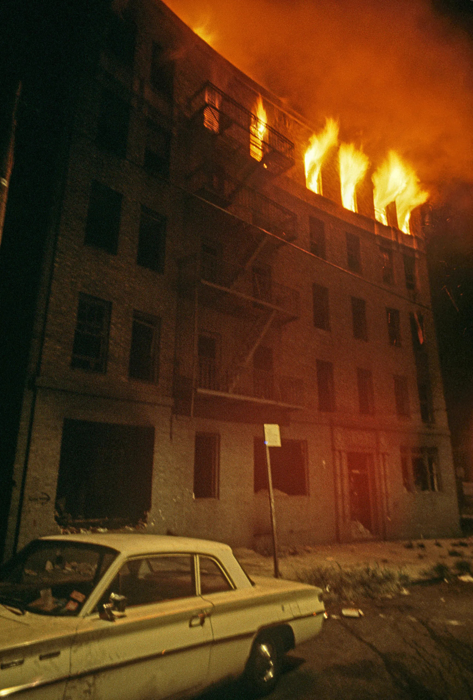
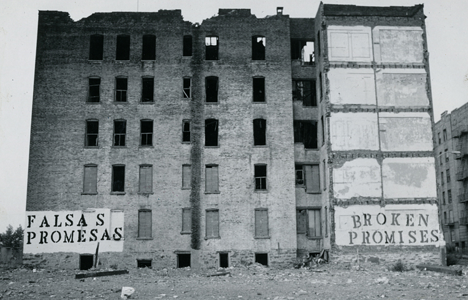



# The Bronx: 1940s-1970s

A spatial history of the Bronx and the infrastructure decisions that shaped it into what we know in the modern day.

## The Map

<iframe src="map/" width="100%" height="520"
style="border:1px solid #ccc; border-radius:8px;"></iframe>

[Read the essay](essay.html)

