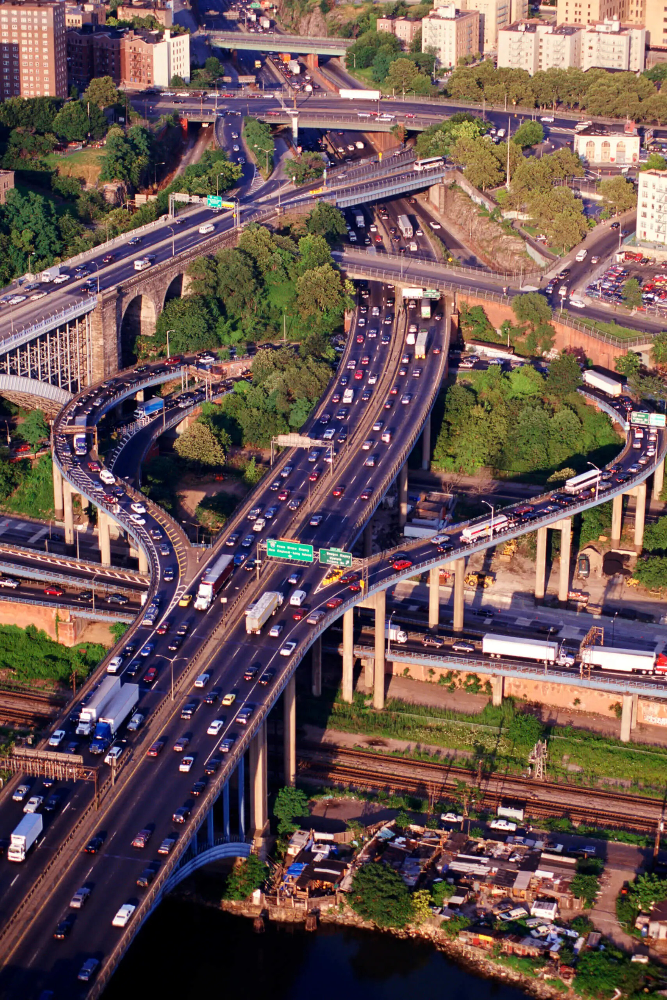
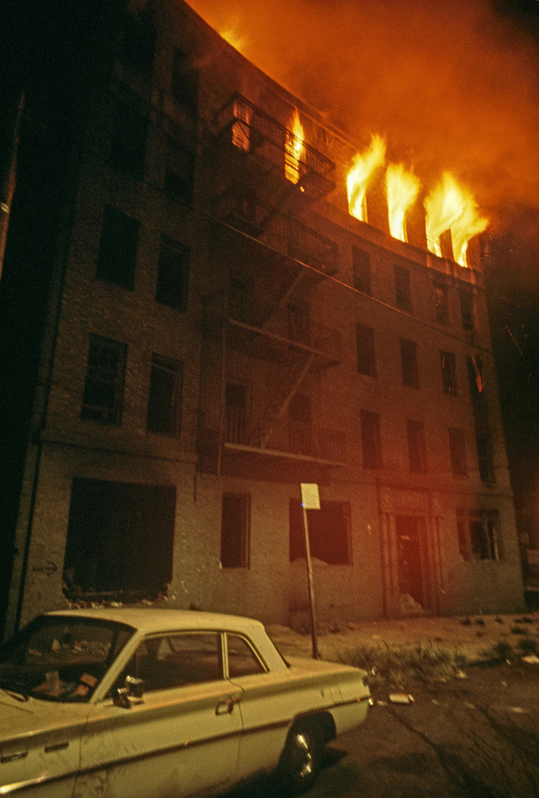
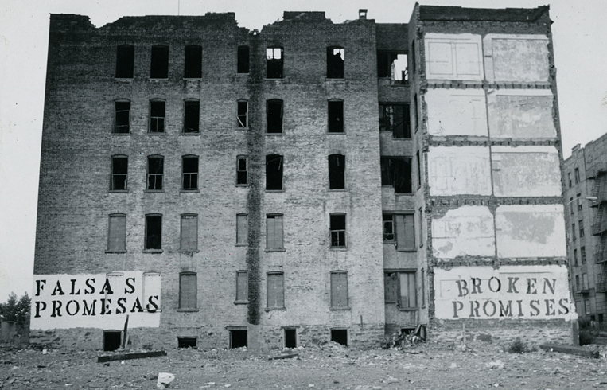

# Your Place and Its World

A spatial history of your place and the places it was tied to.

## The Map

<iframe src="map/" width="100%" height="520"
style="border:1px solid #ccc; border-radius:8px;"></iframe>

## Spatial Analysis of Bronx Infrastructure

1) The Cross-Bronx Expressway was connected to other places within the Bronx by internal and causal relationships, suggesting that the Expressway had a distinct impact on the region as a whole.

3) Something that the map is incapable of showing is where people went after the fires. Due to the chaos of the time and the fact that many families were displaced multiple times, often in fairly quick succession, the records of where people went and settled permanently are incredibly limited. This makes it very difficult to accurately map the movements of people displaced by the fires.

